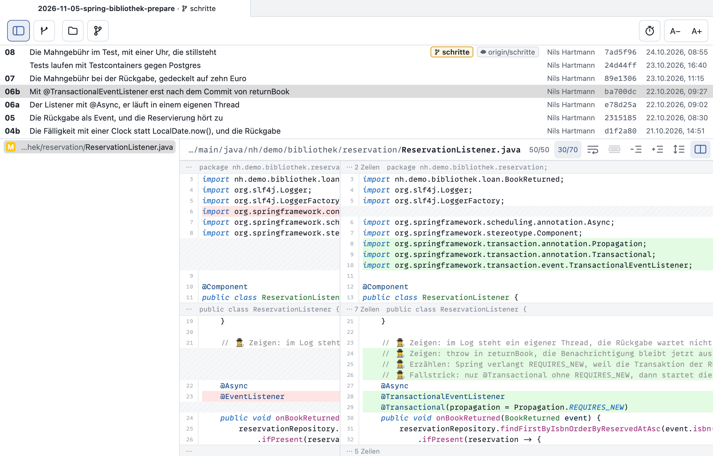
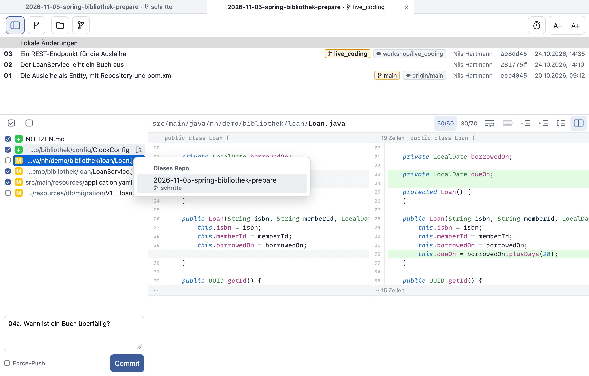
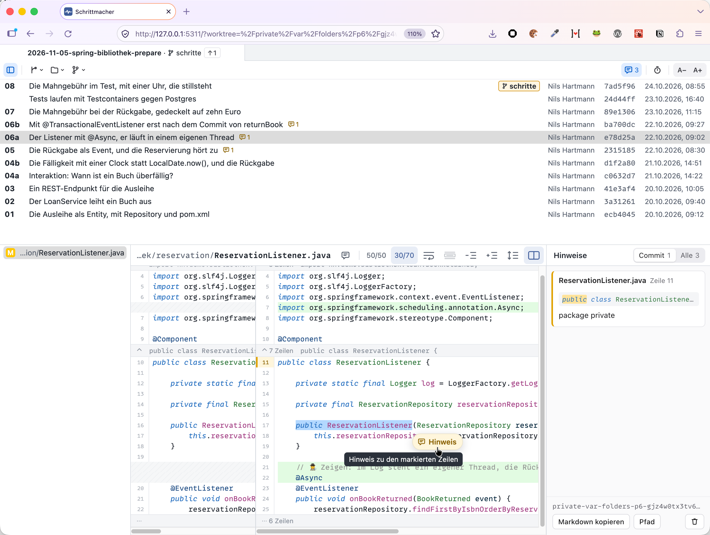
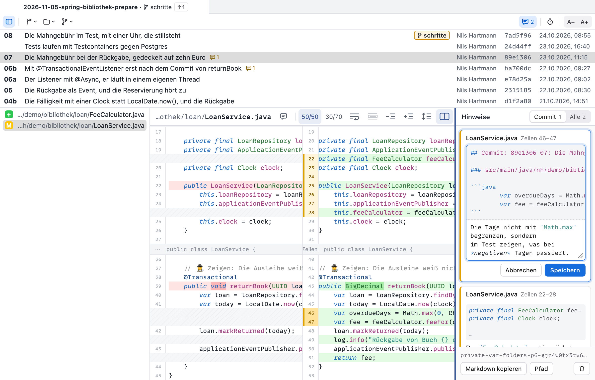
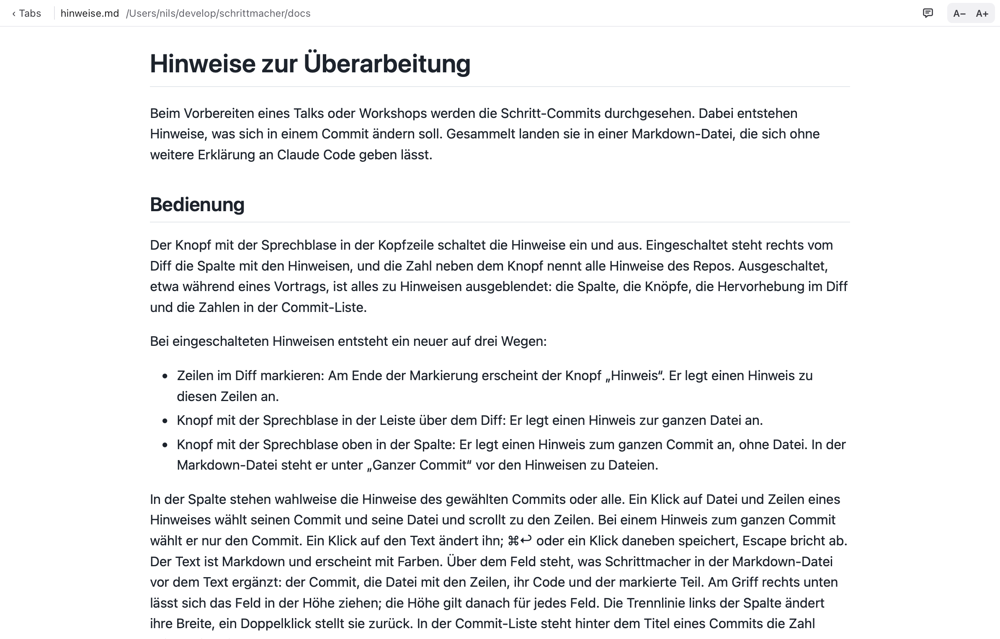
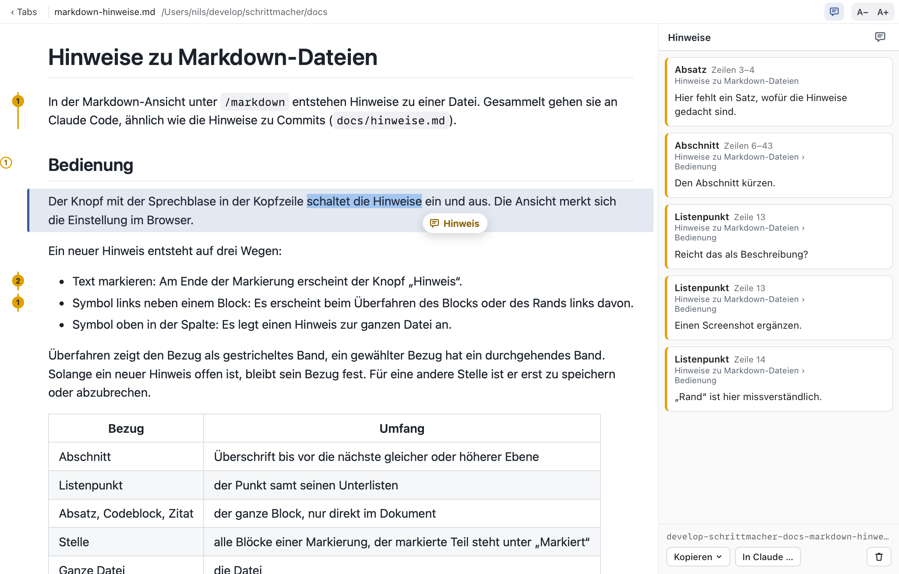
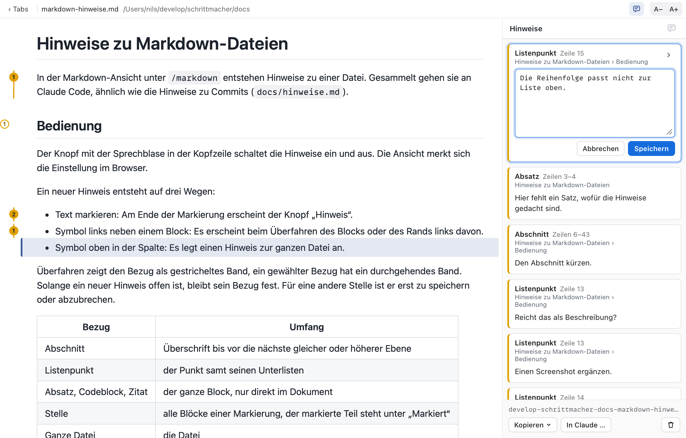
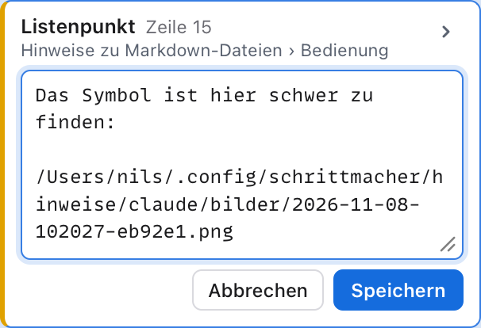

#  Schrittmacher

Git-Viewer für Talks und Workshops. Er zeigt die Schritt-Commits eines Workshop-Repos (`NN: Thema`)
als Spickzettel und zum Kopieren von Code. Gedacht ist er für ein iPad oder ähnliches, das
per Sidecar am Mac hängt. Darstellung und Bedienung folgen [meinem Lieblings-Git-Client Fork](https://git-fork.com/), nutzen die schmale Fläche aber
besser aus: Commit-Liste und Dateiliste lassen sich ganz einklappen, und die rechte Seite des Diffs
darf breiter sein als die linke.





## Start

```sh
pnpm install
pnpm dev        # mit Testdaten
pnpm dev:echt   # mit den Repos aus ~/.config/schrittmacher/config.json
```

Der Server läuft unter <http://127.0.0.1:5310/>. In Safari lässt er sich mit „Zum Dock hinzufügen“
als Web-App ohne Browserleisten anlegen. Mit `bin/schrittmacher [pfad]` öffnet sich ein Worktree
als Tab, wie mit `fork <pfad>`.

## Hinweise zur Überarbeitung

Beim Durchsehen der Schritt-Commits lassen sich Hinweise festhalten, was sich in einem Commit ändern
soll. Der Knopf mit der Sprechblase in der Kopfzeile schaltet sie ein; rechts vom Diff steht dann
die Spalte mit den Hinweisen. Ein Hinweis gilt für markierte Zeilen im Diff oder für eine ganze
Datei. Die Commit-Liste zeigt hinter jedem Commit die Zahl seiner Hinweise. Die Hinweise lassen sich
gesammelt zur Abarbeitung an Claude Code übergeben.



Der Text eines Hinweises ist Markdown. Schrittmacher ergänzt davor den Commit, die Datei mit den
Zeilen und ihren Code. Gesammelt stehen alle Hinweise eines Repos in einer Markdown-Datei, die sich
ohne weitere Erklärung an Claude Code geben lässt. Während eines Vortrags bleiben die Hinweise
ausgeschaltet und damit unsichtbar.



Bedienung, Regeln und Speicherort beschreibt [docs/hinweise.md](docs/hinweise.md).

## Markdown-Ansicht

Schrittmacher zeigt Markdown-Dateien gerendert an, mit Tabellen, Aufgaben, Bildern und den Farben des
Diffs in Codeblöcken. Geöffnet wird eine Datei mit `bin/schrittmacher <datei.md>`. Eine geänderte
Datei lädt die Ansicht von selbst neu, etwa während Claude daran schreibt.



Für „Öffnen mit …“, etwa im Finder, baut `bin/schrittmacher-markdown-installieren` eine kleine
Helfer-App. Sie startet bei Bedarf auch den Server.

### Hinweise zu einer Datei

Der Knopf mit der Sprechblase in der Kopfzeile schaltet die Hinweise ein. Ein Hinweis bezieht sich
auf eine markierte Stelle, einen Abschnitt, einen Listenpunkt, einen Absatz, einen Codeblock, ein
Zitat oder die ganze Datei. Der Text lässt sich dazu markieren, oder links neben dem Block erscheint
beim Überfahren ein Symbol. Ein Band zeigt, worauf sich der Hinweis bezieht. Die Hinweise lassen
sich gesammelt an Claude Code übergeben.

Links vom Text steht an jeder Stelle die Zahl ihrer Hinweise. Ein Klick darauf scrollt in der
Spalte zu den Hinweisen.





**Screenshots**

Ein Screenshot aus der Zwischenablage lässt sich mit ⌘V in das Feld eines Hinweises einfügen.
Schrittmacher legt ihn als Datei ab und setzt ihren Pfad in den Text, sodass Claude Code das Bild
lesen kann.



**Ablage der Dateien**

Die Hinweise werden in einer eigenen Datei festgehalten, die kommentierte Markdown-Datei bleibt
unverändert. Lässt sich eine Stelle nach einer Änderung nicht mehr finden, bleibt ihr Hinweis in der
Spalte stehen.

„In Claude …“ unter der Spalte startet Claude Code mit allen Hinweisen. Das Menü „Kopieren“ legt
das Markdown, den Pfad der gesammelten Datei oder einen fertigen Prompt in die Zwischenablage.

Bedienung, Regeln und Speicherort beschreibt [docs/markdown-hinweise.md](docs/markdown-hinweise.md).
