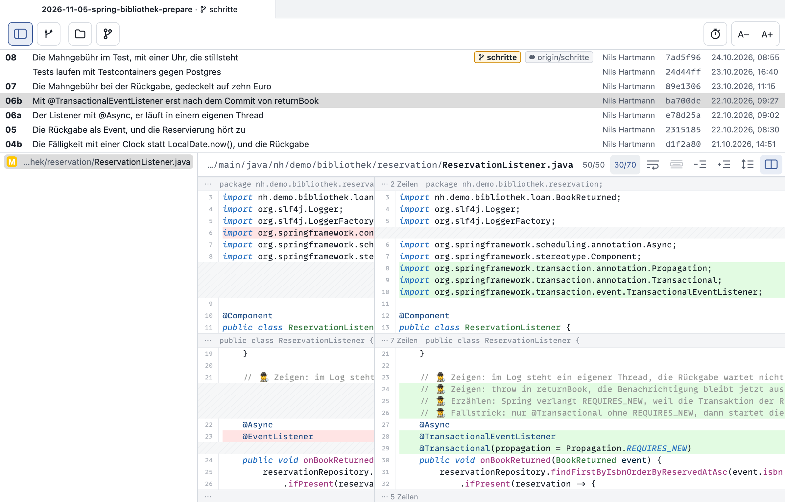
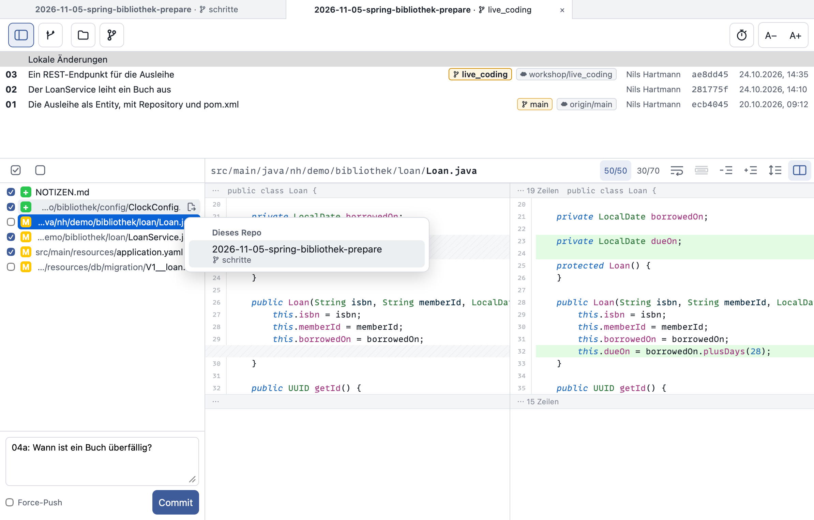

# Schrittmacher

Git-Viewer für Talks und Workshops. Er zeigt die Schritt-Commits eines Workshop-Repos (`NN: Thema`)
als Spickzettel und zum Kopieren von Code. Gedacht ist er für ein iPad oder ähnliches, das
per Sidecar am Mac hängt. Darstellung und Bedienung folgen [meinem Lieblings-Git-Client Fork](https://git-fork.com/), nutzen die schmale Fläche aber
besser aus: Commit-Liste und Dateiliste lassen sich ganz einklappen, und die rechte Seite des Diffs
darf breiter sein als die linke.





## Start

```sh
pnpm install
pnpm dev        # mit Testdaten
pnpm dev:echt   # mit den Repos aus ~/.config/schrittmacher/config.json
```

Der Server läuft unter <http://127.0.0.1:5310/>. In Safari lässt er sich mit „Zum Dock hinzufügen“
als Web-App ohne Browserleisten anlegen. Mit `bin/schrittmacher [pfad]` öffnet sich ein Worktree
als Tab, wie mit `fork <pfad>`.
