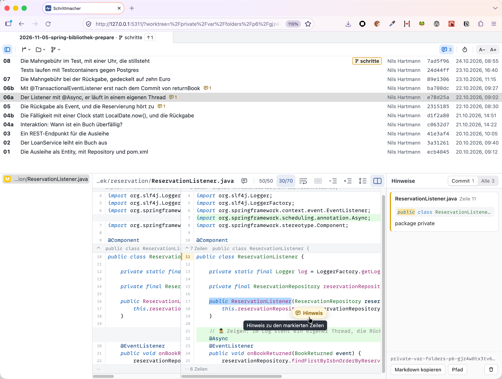
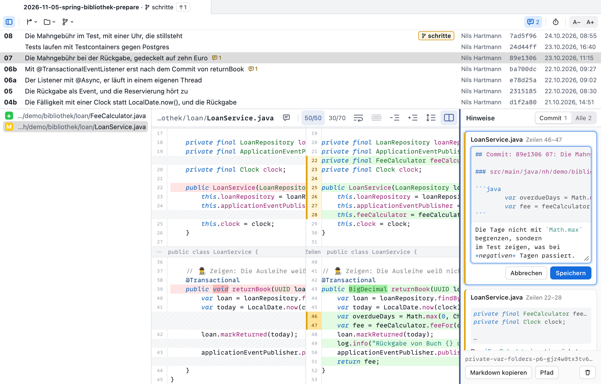

#  Schrittmacher

Git-Viewer für Talks und Workshops. Er zeigt die Schritt-Commits eines Workshop-Repos (`NN: Thema`)
als Spickzettel und zum Kopieren von Code. Gedacht ist er für ein iPad oder ähnliches, das
per Sidecar am Mac hängt. Darstellung und Bedienung folgen [meinem Lieblings-Git-Client Fork](https://git-fork.com/), nutzen die schmale Fläche aber
besser aus: Commit-Liste und Dateiliste lassen sich ganz einklappen, und die rechte Seite des Diffs
darf breiter sein als die linke.


## Start

```sh
pnpm install
pnpm dev        # mit Testdaten
pnpm dev:echt   # mit den Repos aus ~/.config/schrittmacher/config.json
```

Der Server läuft unter <http://127.0.0.1:5310/>. In Safari lässt er sich mit „Zum Dock hinzufügen“
als Web-App ohne Browserleisten anlegen. Mit `bin/schrittmacher [pfad]` öffnet sich ein Worktree
als Tab, wie mit `fork <pfad>`.

## Hinweise zur Überarbeitung

Beim Durchsehen der Schritt-Commits lassen sich Hinweise festhalten, was sich in einem Commit ändern
soll. Der Knopf mit der Sprechblase in der Kopfzeile schaltet sie ein; rechts vom Diff steht dann
die Spalte mit den Hinweisen. Ein Hinweis gilt für markierte Zeilen im Diff oder für eine ganze
Datei. Die Commit-Liste zeigt hinter jedem Commit die Zahl seiner Hinweise.



Der Text eines Hinweises ist Markdown. Schrittmacher ergänzt davor den Commit, die Datei mit den
Zeilen und ihren Code. Gesammelt stehen alle Hinweise eines Repos in einer Markdown-Datei, die sich
ohne weitere Erklärung an Claude Code geben lässt. Während eines Vortrags bleiben die Hinweise
ausgeschaltet und damit unsichtbar.



Bedienung, Regeln und Speicherort beschreibt [docs/hinweise.md](docs/hinweise.md).
